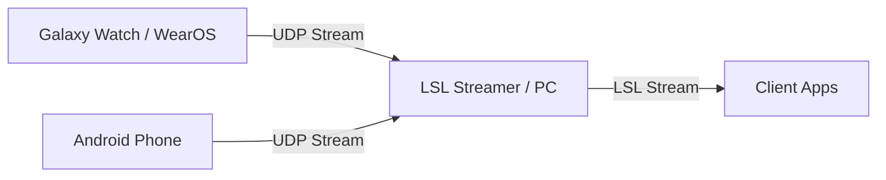

# WatchStreamer


WatchStreamer is an Android and Wear OS application designed to stream sensor data (IMU, Heart Rate, and Touch Events) over UDP to a local network, typically for integration with Lab Streaming Layer (LSL) or other client applications.

## Architecture / Streaming Pipeline



## Features
- **High-frequency sensor streaming:** Accelerometer and Gyroscope data.
- **Biometric streaming:** Heart rate tracking.
- **Touch Event tracking:** X, Y coordinates and touch states for interaction capture.
- **Dual Support:** Modules provided for both Wear OS (e.g., Galaxy Watch) and standard Android devices.
- **Keep-alive Screen:** Prevents the device from sleeping during long recording sessions to maintain continuous data flow.

## Packet Format

Data is sent over UDP, with each packet containing a single line of CSV-formatted text. The format is as follows:

```csv
accX,accY,accZ,gyroX,gyroY,gyroZ,hr,touchX,touchY,isTouched,timestampNs
```

*   **`timestampNs`**: the acquisition time of the sample. A packet is sent on every accelerometer event, stamped with `SensorEvent.timestamp`; gyroscope and heart-rate values ride along as their latest readings. Touch packets use `SystemClock.elapsedRealtimeNanos()`. Both run on the same clock base.
*   This payload string is constructed in `core/StreamState.toPayloadString()` and is verified by tests in `StreamHelperTest`.

## Setup & Installation

### WearOS / Android Installation
1. Enable **Developer Options** and **Wireless Debugging** on your Watch or Phone.
2. Connect your device to the same Wi-Fi network as your development PC.
3. Build the APK using `./gradlew assembleRelease` or by running `make build`.
4. Deploy the APK to your device using `adb install <path_to_apk>` or use the provided deployment script for watches: `./deploy_to_watch.ps1`.

### Network Configuration
1. Setup a Mobile Hotspot on your PC or ensure both the PC and Watch/Phone are on the same local network.
2. Find your PC's IP Address (e.g., `192.168.137.1`).
3. Open the WatchStreamer app on your device, enter the PC's IP address, and tap **"START STREAMING"**.

## Connecting to Nautilus BCI

This application is designed to integrate with [nautilus_bci](https://github.com/JohnGF/nautilus_bci).

To receive the streamed data on your PC, run the bridge script provided in the nautilus_bci repository from its root directory:

```bash
uv run python scripts/bridges/smartwatch_lsl_bridge.py --mode udp --port 5005
```

*(Note: The app streams to UDP port 5005 by default, so you must explicitly specify `--port 5005` as the bridge defaults to 8080).*

This bridge script receives the UDP packets and publishes them as Lab Streaming Layer (LSL) streams `Smartwatch_IMU` and `Smartwatch_PPG`. It maps the `timestampNs` field onto the local LSL time, preserving the original acquisition time of the sensor data rather than the network arrival time.

## Project Structure
- `:app` - Wear OS application module containing the UI and logic for smartwatches.
- `:mobile` - Standard Android application module containing the UI and logic for smartphones.

## Troubleshooting

If you are having trouble connecting the app to your PC, check the following:

1.  **Network**: Ensure both the Android device (watch or phone) and the receiving PC are connected to the **same Wi-Fi network**.
2.  **Target IP**: Ensure you have correctly entered the PC's IP address into the watch or phone app before pressing "Start Streaming".
3.  **Firewall (App)**: Check that the firewall on the receiving PC allows incoming UDP packets on the target port (default: 5005).
4.  **Firewall (LSL)**: For the Lab Streaming Layer to function properly on the network, LSL requires specific ports to be open on your PC:
    *   **UDP**: 16571 - 16636
    *   **TCP**: 16572 - 16636
    *   For a detailed walkthrough, refer to the [nautilus_bci LSL network/firewall guide](https://github.com/JohnGF/nautilus_bci/blob/feature/gpype-pipeline/docs/guides/lsl_network_setup.md).
