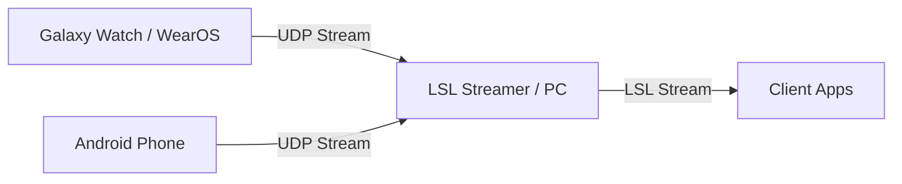

# WatchStreamer


WatchStreamer is an Android and Wear OS application designed to stream sensor data (IMU, Heart Rate, and Touch Events) over UDP to a local network, typically for integration with Lab Streaming Layer (LSL) or other client applications.

## Architecture / Streaming Pipeline



## Features
- **High-frequency sensor streaming:** Accelerometer and Gyroscope data.
- **Biometric streaming:** Heart rate tracking.
- **Touch Event tracking:** X, Y coordinates and touch states for interaction capture.
- **Dual Support:** Modules provided for both Wear OS (e.g., Galaxy Watch) and standard Android devices.
- **Keeps streaming with the screen off (watch):** Streaming runs in a health-type foreground service with a wake lock, a bound Wi-Fi network and a low-latency Wi-Fi lock, shown as an Ongoing Activity on the watch face. Lowering the wrist or covering the watch no longer stops the stream, and the socket is rebuilt when Wi-Fi comes back.

## Packet Format

The watch app (`:app`, v1.2+) sends **W2** packets, the multi-device format shared with ESP32 boards and other wearables. Full spec: [nautilus_bci wearable protocol](https://johngf.github.io/nautilus_bci/guides/wearable_protocol/).

```text
W2|<device_id>|<location>|<seq>|<kind>[@<rate_hz>]|<t_ns>,<v1>,...;<t_ns>,<v1>,...
```

*   **`device_id`**: `wear-` plus the last 6 characters of the watch's `ANDROID_ID`; stable across restarts.
*   **`location`**: picked on the setup screen (`L_wrist`, `R_wrist`, `L_ankle`, `R_ankle`). Give each device a different one; the bridge names the LSL streams after it (`IMU_L_wrist`, `HR_L_wrist`, ...).
*   **Kinds**: `IMU@50` (accel + latest gyro, 5 samples per packet), `HR` (on each heart-rate event), `TOUCH` (x, y, touched), `HB` (once a second: sent, dropped, battery %).
*   **`t_ns`**: `SensorEvent.timestamp` for sensor samples, `SystemClock.elapsedRealtimeNanos()` otherwise; same clock base, so the bridge maps every kind onto LSL time with one per-device offset.
*   Built in `core/WireProtocol.kt`, tested in `WireProtocolTest`.
*   **Clock sync (v1.3+)**: the app answers the bridge's `W2P|<id>` pings with `ECHO` packets (arrival time, turnaround) from a dedicated thread. The bridge uses them to measure each watch's clock offset and drift NTP-style, to within about ±2 ms on Wi-Fi.

The `:mobile` phone app still sends the legacy single-device CSV (`accX,accY,accZ,gyroX,gyroY,gyroZ,hr,touchX,touchY,isTouched,timestampNs`), which the bridge publishes as `Smartwatch_IMU` / `Smartwatch_PPG`.

### Several devices at once

Install the app on each watch, pick a different location on each, and point them all at the same PC IP. One bridge handles all of them and prints a status line per device every 5 s (rate, packet loss, battery, last seen).

## Setup & Installation

### WearOS / Android Installation
1. Enable **Developer Options** and **Wireless Debugging** on your Watch or Phone.
2. Connect your device to the same Wi-Fi network as your development PC.
3. Build the APK using `./gradlew assembleRelease` or by running `make build`.
4. Deploy the APK to your device using `adb install <path_to_apk>` or use the provided deployment script for watches: `./deploy_to_watch.ps1`.

### Network Configuration
1. Setup a Mobile Hotspot on your PC or ensure both the PC and Watch/Phone are on the same local network.
2. Find your PC's IP Address (e.g., `192.168.137.1`).
3. Open the WatchStreamer app on your device, enter the PC's IP address, and tap **"START STREAMING"**.

## Connecting to Nautilus BCI

This application is designed to integrate with [nautilus_bci](https://github.com/JohnGF/nautilus_bci).

To receive the streamed data on your PC, run the bridge script provided in the nautilus_bci repository from its root directory:

```bash
uv run python scripts/bridges/smartwatch_lsl_bridge.py --mode udp --port 5005
```

*(Note: The app streams to UDP port 5005 by default, so you must explicitly specify `--port 5005` as the bridge defaults to 8080).*

This bridge script receives the UDP packets and publishes one set of Lab Streaming Layer (LSL) streams per device (`IMU_<location>`, `HR_<location>`, `TOUCH_<location>`). It maps each device's `t_ns` onto the local LSL time, preserving the original acquisition time of the sensor data rather than the network arrival time. W2 needs a bridge from nautilus_bci with `scripts/bridges/wearable_protocol.py`.

## Project Structure
- `:app` - Wear OS application module containing the UI and logic for smartwatches.
- `:mobile` - Standard Android application module containing the UI and logic for smartphones.

## Troubleshooting

If you are having trouble connecting the app to your PC, check the following:

1.  **Network**: Ensure both the Android device (watch or phone) and the receiving PC are connected to the **same Wi-Fi network**.
2.  **Target IP**: Ensure you have correctly entered the PC's IP address into the watch or phone app before pressing "Start Streaming".
3.  **Stream stops when the screen goes off (watch)**:
    *   Accept the **body sensors** permission and then **"Allow all the time"** for background body sensors; without the second one, heart rate can stop with the screen off. Over adb: `adb shell pm grant com.nautilus.watchstreamer android.permission.BODY_SENSORS_BACKGROUND`.
    *   Accept the battery optimization exemption the app asks for on first launch (`adb shell dumpsys deviceidle whitelist +com.nautilus.watchstreamer` does the same).
    *   On Galaxy watches, make sure the app is not in **Settings → Battery → Background usage limits → Sleeping apps**.
    *   The on-screen status line shows `Waiting for Wi-Fi` while the watch has no Wi-Fi; packets sent in that window are counted as dropped.
4.  **Firewall (App)**: Check that the firewall on the receiving PC allows incoming UDP packets on the target port (default: 5005).
5.  **Firewall (LSL)**: For the Lab Streaming Layer to function properly on the network, LSL requires specific ports to be open on your PC:
    *   **UDP**: 16571 - 16636
    *   **TCP**: 16572 - 16636
    *   For a detailed walkthrough, refer to the [nautilus_bci LSL network/firewall guide](https://github.com/JohnGF/nautilus_bci/blob/feature/gpype-pipeline/docs/guides/lsl_network_setup.md).
