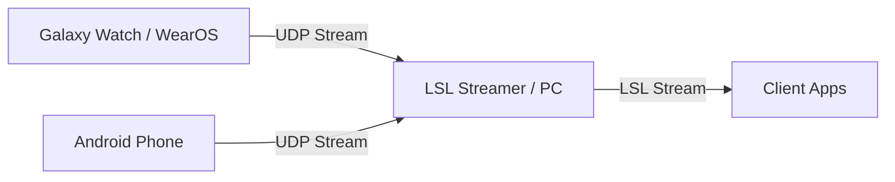

# WatchStreamer

WatchStreamer is an Android and Wear OS application designed to stream sensor data (IMU, Heart Rate, and Touch Events) over UDP to a local network, typically for integration with Lab Streaming Layer (LSL) or other client applications.

## Architecture / Streaming Pipeline

## Features
- **High-frequency sensor streaming:** Accelerometer and Gyroscope data.
- **Biometric streaming:** Heart rate tracking.
- **Touch Event tracking:** X, Y coordinates and touch states for interaction capture.
- **Dual Support:** Modules provided for both Wear OS (e.g., Galaxy Watch) and standard Android devices.
- **Keep-alive Screen:** Prevents the device from sleeping during long recording sessions to maintain continuous data flow.

## Setup & Installation

### WearOS / Android Installation
1. Enable **Developer Options** and **Wireless Debugging** on your Watch or Phone.
2. Connect your device to the same Wi-Fi network as your development PC.
3. Build the APK using `./gradlew assembleRelease` or by running `make build`.
4. Deploy the APK to your device using `adb install <path_to_apk>` or use the provided deployment script for watches: `./deploy_to_watch.ps1`.

### Network Configuration
1. Setup a Mobile Hotspot on your PC or ensure both the PC and Watch/Phone are on the same local network.
2. Find your PC's IP Address (e.g., `192.168.137.1`).
3. Open the WatchStreamer app on your device, enter the PC's IP address, and tap **"START STREAMING"**.

## Project Structure
- `:app` - Wear OS application module containing the UI and logic for smartwatches.
- `:mobile` - Standard Android application module containing the UI and logic for smartphones.
